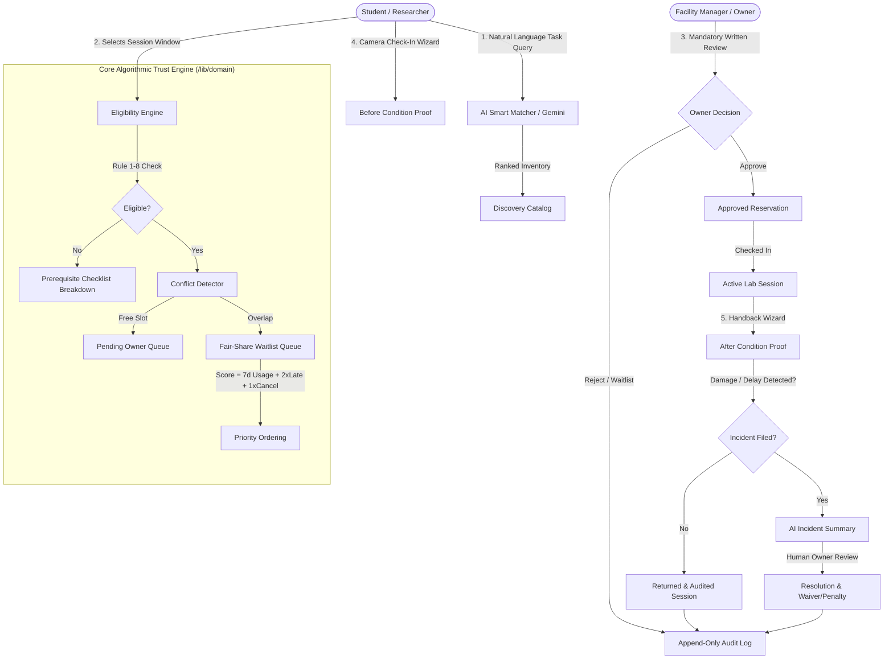

# LabLend — Campus Resource & Equipment Governance Protocol
> **Hackathon Track**: "Unlock Underused Equipment and Spaces"  
> **Production Target**: Vercel + Supabase + Google Gemini  
> **Campus Scope**: Single-Tenant Higher Education Institution (Engineering, Makerspaces, Media & Research Labs)

---

## 1. Executive Summary & Why the Problem Matters

Across university campuses worldwide, millions of dollars worth of advanced scientific equipment, industrial makerspace tools, camera kits, and seminar rooms sit idle for up to 70% of the academic calendar. Simultaneously, undergraduate and graduate students face severe bottlenecks attempting to access gear needed for capstone engineering projects, thesis experiments, and creative coursework.

Traditional ad-hoc solutions fail due to institutional friction:
1. **Departmental Silos**: Equipment purchased with one department's grant remains hidden from other faculties.
2. **Booking Hoarding**: Users reserve prime Friday/weekend slots with no intention of using them, locking out peers.
3. **Accountability Deficit**: When an expensive 3D printer nozzle oxidizes or an oscilloscope probe snaps, finger-pointing ensues because there is no verified condition handback record.
4. **Safety & Prerequisite Risks**: Lab managers fear lending high-risk class-4 laser cutters or high-voltage equipment to untrained students.

**LabLend** solves institutional resource sharing through a **Trust-First Architecture**: automated prerequisite safety checks, an algorithmic fair-use priority queue that eliminates hoarding, tamper-evident before/after photo check-in/return, and an immutable append-only audit trail.

---

## 2. Target Users & Personas

- **Undergraduate & Graduate Students** (e.g. *Aarav Patel, Riya Sharma, Kabir Sen*): Need quick, predictable discovery, clear prerequisite requirements, and transparent queue status when slots are contested.
- **Facility Owners & Lab Technicians** (e.g. *Dr. Anita Mehta, Prof. Suresh Rao*): Require full supervision oversight, verified training proof, mandatory written reasons for decisions, and automated incident logging.
- **Campus Operations Administrators** (e.g. *Elena Vance*): Need institutional governance, owner identity verification, qualification approval queues, utilization analytics, and append-only audit records.

---

## 3. System Architecture & Workflow

### Architecture Diagram (Mermaid)



---

## 4. Complete End-to-End Workflow

1. **Discover**: Natural language matching ("I need to measure a signal on Saturday") returns ranked instruments with personalized eligibility badges.
2. **Eligibility Verification**: Pure function evaluates 8 campus rules (operational status, future time, duration $\le$ max hours, department restrictions, safety certification, open hours, blackout dates, and rolling 7-day 8-hour cap).
3. **Conflict Detection & Fair-Share Queueing**: If a slot overlaps with an active reservation, the system auto-waitlists the request, computes their Fair-Share Score, and presents the 3 nearest free alternatives.
4. **Owner Review**: Facility owners review pending requests ordered by fair-share priority. A written reason is **mandatory** for transparency.
5. **Photo Check-In**: The student uploads physical inspection photos and verifies safety interlocks, moving the booking to `checked_in`.
6. **Return Handback & Incident Logging**: Student verifies clean condition with return photos. If damage occurred, an incident is filed.
7. **Human-in-the-Loop Resolution**: Gemini API provides an advisory incident summary; the human owner reviews photos and records the final resolution.
8. **Append-Only Audit**: All transitions are permanently recorded in PostgreSQL with triggers blocking `UPDATE` and `DELETE`.

---

## 5. Technology Stack & Implementation Details

| Layer | Technologies Selected | Justification |
| :--- | :--- | :--- |
| **Framework** | Next.js 16 (App Router, Turbopack) | Server Components, streaming Suspense, typed routing, React 19 compatibility |
| **Styling** | Tailwind CSS + Lucide React | High-contrast campus-lab aesthetics, responsive dark mode, accessible WCAG AA focus rings |
| **Database** | PostgreSQL / Supabase | Row Level Security (RLS), GiST exclusion constraints, append-only triggers |
| **Domain Logic** | TypeScript Strict (`/src/lib/domain`) | Pure, deterministic business logic independent of UI layers |
| **Validation** | Zod + React Hook Form | Strict client & server-side request validation |
| **AI Layer** | `@google/generative-ai` (Gemini API) | Server-side natural-language task matching and incident summarization |
| **Testing** | Vitest + Playwright | 12 pure-domain unit tests + full end-to-end user journey test |

---

## 6. AI Usage & Human-Oversight Boundaries

LabLend adheres strictly to ethical AI guidelines for institutional environments:
- **Advisory Only**: AI models are restricted to assistive tasks (natural-language search parsing and summarizing damage reports).
- **Zero Autonomous Enforcement**: AI **never** approves, rejects, bans, or assesses financial penalties.
- **Auditable Suggestions**: AI-generated views are marked with an advisory disclaimer (*"AI suggestion, owner decides"*).
- **Graceful Fallback**: If `GEMINI_API_KEY` is missing or rate-limited, the system seamlessly uses local synonym vector rules with zero disruption.

---

## 7. Privacy, Security & Fairness Design

- **Data Minimization**: Only campus email, department, student ID number, and verified qualification records are stored.
- **Private Storage**: Inspection photos and certificate evidence reside in private storage accessible only via authenticated signed URLs.
- **Concealed Peer Identities**: Waitlisted students see their numerical position (e.g. *Rank #1*) without revealing competing student names.
- **Append-Only Immutability**:
  ```sql
  CREATE TRIGGER trg_audit_log_append_only
  BEFORE UPDATE OR DELETE ON audit_log
  FOR EACH ROW
  EXECUTE FUNCTION prevent_audit_log_modification();
  ```

---

## 8. Known Limitations & Future Work

- **Hardware IoT Integration**: Integration with physical NFC badge readers and smart electronic lockboxes for keyless lab entry.
- **Multi-Tenant University Federation**: Allowing cross-institution sharing between neighboring college campuses.
- **Push Notification Channels**: SMS/WhatsApp reminders 1 hour before return deadlines.

---

## 9. Disclosures & Attribution

- **AI Tools Used**: Google Antigravity Coding Assistant (code generation, refactoring, and test authoring).
- **Libraries**: Next.js, React, Tailwind CSS, Lucide React, Vitest, Playwright, `@supabase/supabase-js`, `@google/generative-ai`.
- **Media**: Unsplash royalty-free photography for demo campus equipment inventory.
